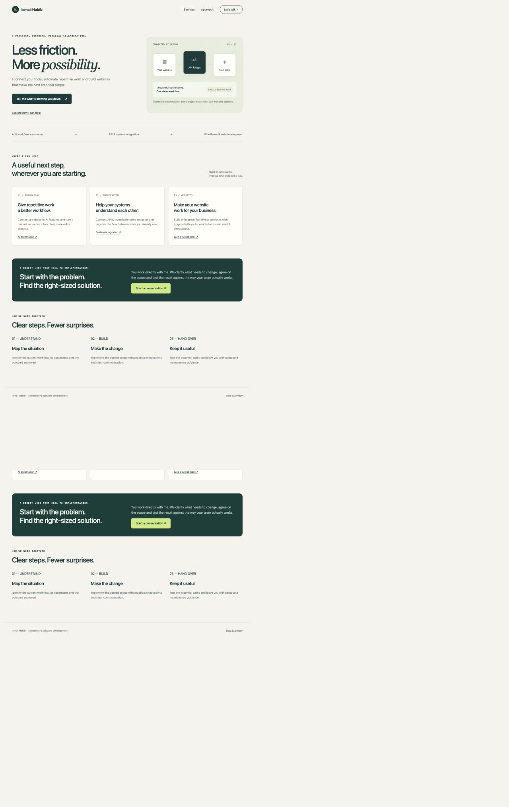
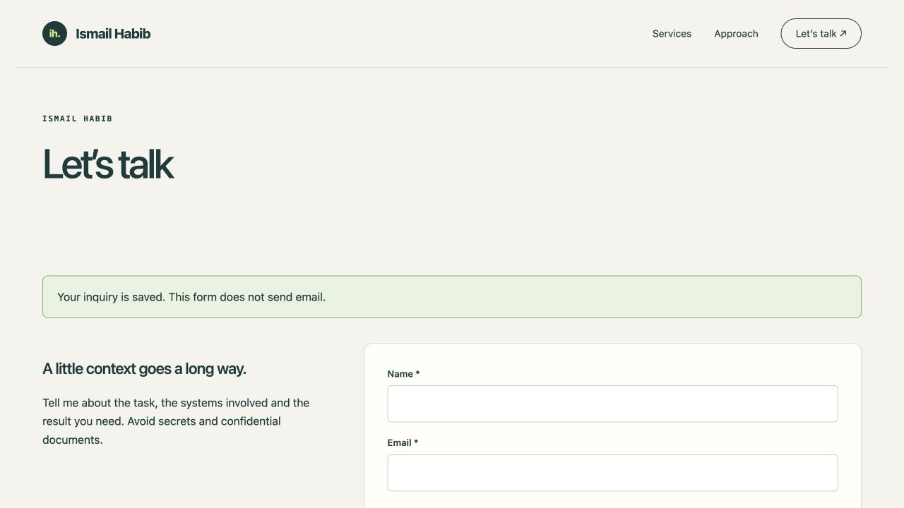

# Ismail Studio — Service Website & Inquiry Desk

A responsive service website with a custom WordPress theme and an inquiry-management plugin. Visitors can explore services and submit a validated inquiry; administrators can review, export and delete records in WordPress. A separate Python implementation is also included.

An independent project by Ismail Habib. Screenshots show the running application; any records shown are labelled verification data.

## Screenshots



WordPress service homepage with responsive navigation and service sections.



Confirmation after submitting a labelled verification inquiry to the running WordPress application.

## Features

- Responsive homepage, service pages and contact workflow.
- Server-side form validation, nonce protection and stored inquiry records.
- Authenticated WordPress inquiry desk with review state, CSV export and deletion.
- Installable theme/plugin ZIPs and a reproducible local Docker setup.

## Quick start: WordPress

Run these commands from the repository directory.

Requirements: Docker Desktop running, Python 3, and internet access for the first image download.

```sh
python3 wordpress_setup.py
```

Open http://127.0.0.1:8187. This starts an isolated WordPress installation and MariaDB database, installs the included original theme and plugin, and prepares the content. Both Docker images are pinned by digest. WordPress 7.1.2 was actually executed during verification.

Admin: http://127.0.0.1:8187/wp-admin/ . Username: `portfolio_admin`. The generated password is the `WP_ADMIN_PASSWORD` value in `.local.env`. Keep that file local; do not publish it. The file is generated on first run and is excluded from the deliverable. A fresh setup chooses a unique Docker project name, so it does not collide with the temporary verification environment. Keep the generated file to preserve access to that installation on subsequent runs. An example.invalid email is used for this local installation and setup mail is disabled. The database is stored in a dedicated Docker volume. No other project database is modified.

Stop without deleting data:

```sh
docker compose --env-file .local.env stop
```

Restart from this folder:

```sh
docker compose --env-file .local.env up -d
```

## Install on an existing WordPress site

1. Back up the site and test on staging.
2. Upload `ismail-studio.zip` through Appearance → Themes → Add New → Upload Theme, then activate it.
3. Upload `ismail-inquiries.zip` through Plugins → Add New → Upload Plugin, then activate it.
4. Save Settings → Permalinks to refresh rewrite rules.

Theme and plugin sources are in `wordpress/`. The included Docker bootstrap is only for the independent local installation; do not copy it into a live site’s public directory.

## Lightweight standalone runtime

```sh
python3 app.py
```

Open http://127.0.0.1:8107. This alternate implementation requires only Python’s standard library. It is a functioning application with the same original design and content; it is not an embedded WordPress installation. The WordPress and Python runtimes have separate storage. `PORT` can override the standalone port.

## Verification

```sh
python3 test_app.py
python3 test_wordpress.py
```

The first command launches its own temporary standalone test server. The second checks the running WordPress installation at its documented default port. See `TEST_RESULTS.md` for the exact checks and limitations.

## Scope and ownership

Original code, editorial content, layouts and CSS illustration assets are included. System fonts are used; there are no external image/font dependencies and no videos. `CASE_STUDY.md` describes only the implemented work and observed results. The screenshots above were captured from the running WordPress application.

## Before public deployment

The included setup binds only to localhost. Use HTTPS, a proper host, strong administrator access and a site-specific privacy/retention policy before exposing a service publicly. The independent WordPress package can be installed on hosting after staging checks; this deliverable does not claim a public launch or client adoption.

## Service website behavior

The site contains a custom homepage, service descriptions, an approach page and a validated contact form. Valid inquiries are stored in the current runtime’s database. No email is sent. WordPress administrators can review, mark reviewed, export CSV and delete inquiries through the **Inquiry desk** menu. The standalone runtime offers `/inbox` and `/export` on loopback only; that staff route is not a public administration system. The Python inbox has no login and must remain bound to loopback.

Server-side validation checks email format, allowed service choices, name/message lengths and consent. Form submissions use nonce/session protection. Stored inquiry text is escaped in the staff view; CSV cells beginning with spreadsheet formula characters are prefixed. A honeypot adds a basic spam check; public hosting still requires traffic limits/abuse controls appropriate to its environment.

The standalone SQLite file is created in `data/inquiries.sqlite3`; `PORTFOLIO_DB` can override it. Tests use a temporary database and remove fixtures. WordPress activation creates the required content pages only if their slugs do not already exist. Deactivating the plugin retains inquiries intentionally; use the staff inbox to delete records you no longer need.

## License

[MIT License](LICENSE) — Copyright (c) 2026 Ismail Habib.

The license covers the original code and content in this repository. WordPress, MariaDB and other separately installed dependencies retain their own licenses.
